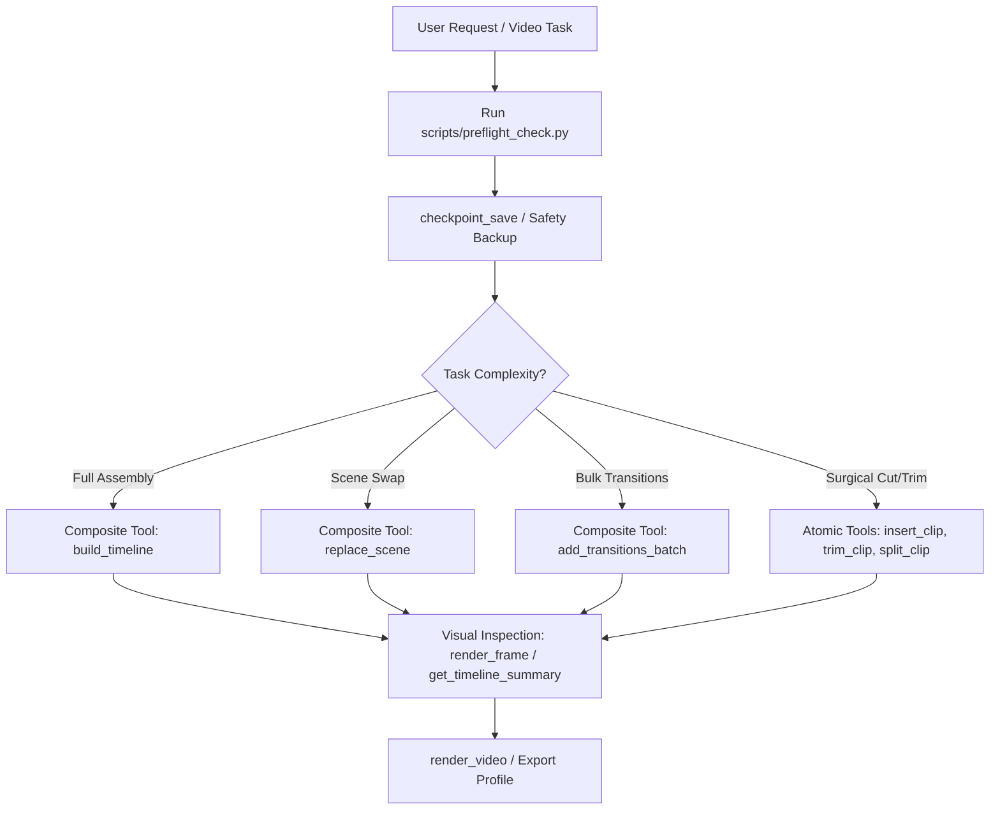

# Kdenlive Editor Agent Skill

Autonomous controller and operational standard for video editing in **Kdenlive** using the MCP integration suite (`mcp-kdenlive` / `kdenlive-api`) and MLT timeline orchestration.

---

## 1. Architectural Principles & Operational Hierarchy

To preserve token context and guarantee timeline safety, always follow the **Composite-First Hierarchy**:

### Hierarchy Rules:
1. **Tier 1 (High-Level Composite Tools):** ALWAYS prefer composite batch operations:
   - `build_timeline`: Complete timeline assembly (media ingest, track distribution, sequencing, transitions, audio).
   - `replace_scene`: Replaces a specific clip without disturbing timeline offsets or existing transitions.
   - `add_transitions_batch`: Inserts cross-dissolves across contiguous clips on a given video track.
   - `get_timeline_summary`: Low-token ASCII table summarizing tracks, clips, in/out points, and transitions.
2. **Tier 2 (Atomic Operations):** Fall back to atomic calls only when surgical precision is needed:
   - `insert_clip`, `move_clip`, `trim_clip`, `split_clip`, `add_track`, `delete_clip`.
3. **Tier 3 (Safety Protocols):**
   - Execute `checkpoint_save` before applying destructive track splits or major reorganizations.
   - Execute `checkpoint_restore` immediately if a batch operation misaligns timeline timecodes.

---

## 2. Core Workflows

### A. Timeline Assembly & Cuts
When building a video sequence from raw footage:
1. Inspect available assets in the media pool (`get_media_pool` or `import_media_glob`).
2. Order clips chronologically or according to narrative scene markers.
3. Call `build_timeline` specifying:
   - `clips`: ordered list of clip paths or bin IDs.
   - `track`: destination track index (default `0` for primary video).
   - `transitions`: enabled cross-dissolve duration (standard `12` to `25` frames).
4. Run `get_timeline_summary` to verify that no accidental overlaps or black frame gaps exist.

### B. Color Correction & Lighting
Kdenlive uses the Frei0r filter engine for professional color grading:
- **Three-Point Color Balance (Lift, Gamma, Gain):**
  - `Lift`: Shadows and black levels.
  - `Gamma`: Midtones and facial exposure.
  - `Gain`: Highlights and overall illumination.
- **Curves (Curvas RGB):**
  - Apply an S-curve for high-contrast cinematic punch.
- **White Balance (Balanço de Branco):**
  - Calibrate color temperature (neutralize yellowish or bluish casts).
- *See [effects_and_color.md](file:///C:/Users/alexa/.gemini/config/skills/kdenlive-editor/references/effects_and_color.md) for parameter ranges and filter IDs.*

### C. Motion Animations & Keyframes
- Add the `Transform` effect to clips or title layers.
- Define keyframes:
  - **Smooth Ken Burns Pan/Zoom:** Start at 100% scale, end at 110%-115% scale with smooth cubic spline interpolation.
  - **Slide In / Slide Out:** Animate X/Y position parameters across the first/last 15 frames.

### D. Subtitles & Typography
- **Subtitles:**
  - Create subtitle items on the dedicated subtitle track.
  - Recommended formatting: High-contrast sans-serif (Montserrat, Poppins), thick outline (2-4px black), drop shadow.
- **Title Clips (Lower Thirds & Headings):**
  - Create title clips via `add_title` with semitransparent background banners for clear legibility over video.

### E. Transitions & Compositions
- **Mix / Dissolve:** Cross-fade between adjacent clips on the same track.
- **Wipe (Limpar):** Apply grayscale Luma matte patterns for directional sweeps, blinds, and iris wipes.
- *See [transition_types.md](file:///C:/Users/alexa/.gemini/config/skills/kdenlive-editor/references/transition_types.md) for full catalog.*

---

## 3. Pre-Render & Export Protocol

Before triggering `render_video`:
1. **Summary Audit:** Call `get_timeline_summary` to verify final duration and track alignment.
2. **Visual Spot-Check:** Call `render_frame` at critical points (start, scene transitions, middle, climax) to confirm visual integrity.
3. **Profile Selection:** Choose target format (YouTube 1080p60, Shorts 9:16, ProRes archive).
   - *See [render_profiles.md](file:///C:/Users/alexa/.gemini/config/skills/kdenlive-editor/references/render_profiles.md) for presets.*
