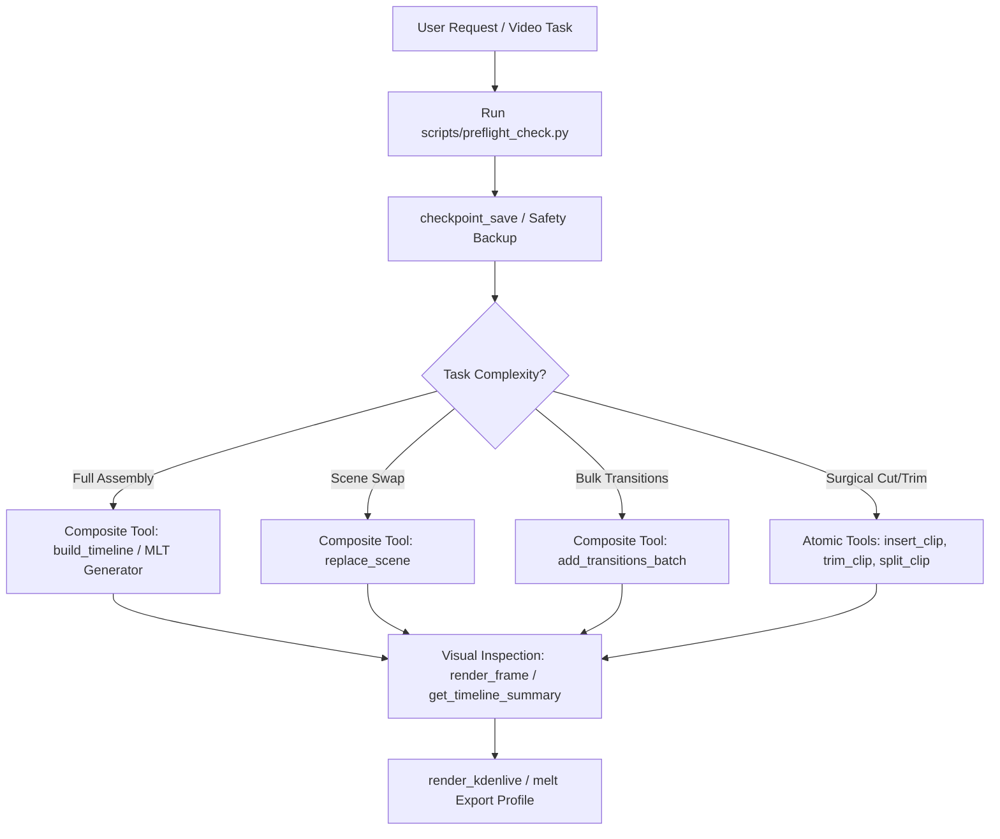

# Kdenlive Editor Agent Skill (Linux Native)

Autonomous controller and operational standard for video editing in **Kdenlive** using native Linux integration (`/usr/bin/kdenlive`), the MLT Framework CLI (`/usr/bin/melt`), and automated timeline orchestration.

---

## 1. Architectural Principles & Operational Hierarchy

To preserve token context and guarantee timeline safety, always follow the **Composite-First Hierarchy**:

### Hierarchy Rules:
1. **Tier 1 (High-Level Composite Operations):** Prefer composite batch operations:
   - `build_timeline`: Complete timeline assembly (media ingest, track distribution, sequencing, transitions, audio).
   - `replace_scene`: Replaces a specific clip without disturbing timeline offsets or existing transitions.
   - `add_transitions_batch`: Inserts cross-dissolves across contiguous clips on a given video track.
   - `get_timeline_summary`: Low-token table summarizing tracks, clips, in/out points, and transitions.
2. **Tier 2 (Atomic Operations):** Fall back to atomic operations when surgical precision is needed:
   - `insert_clip`, `move_clip`, `trim_clip`, `split_clip`, `add_track`, `delete_clip`.
3. **Tier 3 (Safety Protocols):**
   - Save project checkpoints (`.kdenlive.bak`) before applying major track reorganizations.

---

## 2. Core Workflows

### A. Timeline Assembly & Cuts
When building a video sequence from raw footage:
1. Inspect available assets in the media pool.
2. Order clips chronologically or according to narrative scene markers.
3. Call `kdenlive_project_builder.py` or timeline generators specifying:
   - `clips`: ordered list of clip paths.
   - `tracks`: destination track hierarchy (V1 base, V2 overlays/cards, V3 badges, A1 voice, A2 SFX).
   - `profile`: standard 1080p60/30 (16:9) or vertical_hd_30/60 (9:16).

### B. Color Correction & Lighting
Kdenlive uses the Frei0r filter engine for professional color grading:
- **Three-Point Color Balance (Lift, Gamma, Gain):**
  - `Lift`: Shadows and black levels.
  - `Gamma`: Midtones and facial exposure.
  - `Gain`: Highlights and overall illumination.
- **Curves (Curvas RGB):** Apply an S-curve for high-contrast cinematic punch.
- **White Balance:** Calibrate color temperature (neutralize yellowish or bluish casts).
- *See [effects_and_color.md](file:///home/alex/.gemini/config/skills/kdenlive-editor/references/effects_and_color.md) for parameter ranges and filter IDs.*

### C. Motion Animations & Keyframes
- Add the `Transform` effect to clips or title layers.
- Define keyframes:
  - **Smooth Ken Burns Pan/Zoom:** Start at 100% scale, end at 110%-115% scale with smooth cubic spline interpolation.
  - **Slide In / Slide Out:** Animate X/Y position parameters across the first/last 15 frames.

### D. Subtitles & Typography
- **Subtitles:** Create subtitle items on the dedicated subtitle track (`.srt` format).
- **Title Clips (Lower Thirds & Headings):** Create title clips with semitransparent glassmorphic background banners for clear legibility over video.

### E. Transitions & Compositions
- **Mix / Dissolve:** Cross-fade between adjacent clips on the same track.
- **Wipe (Limpar):** Apply grayscale Luma matte patterns for directional sweeps, blinds, and iris wipes.
- *See [transition_types.md](file:///home/alex/.gemini/config/skills/kdenlive-editor/references/transition_types.md) for full catalog.*

---

## 3. Pre-Render & Export Protocol

Before triggering rendering:
1. **Visual Spot-Check:** Verify critical frames (start, scene transitions, climax) to confirm visual integrity.
2. **Profile Selection:** Choose target format (YouTube 1080p60, Shorts/Reels 9:16 vertical, Master archive).
   - *See [render_profiles.md](file:///home/alex/.gemini/config/skills/kdenlive-editor/references/render_profiles.md) for presets.*
3. **Headless Execution:** Render via `/usr/bin/melt` in the background with `-progress` and `-consumer avformat`.
