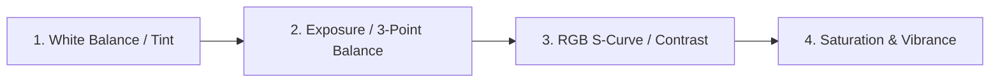

# Kdenlive Color Grading, Lighting & Effects Reference

Comprehensive catalog of the Frei0r and MLT effects used for lighting, color correction, and animations.

---

## 1. Color Grading & Lighting Pipeline

Always apply color and lighting adjustments in the following logical sequence:

### A. Three-Point Balance (`three_point_balance`)
Separates tonal range into three independent regions:
* **Lift (Shadows):**
  * Target: Deep blacks without crushing details into pure 0 IRE.
  * RGB Offset: Adds subtle cool tones (cyan/blue) to shadows if cinematic contrast is desired.
* **Gamma (Midtones):**
  * Target: Skin tones and overall scene exposure. Keep skin luminance between 50–70 IRE.
* **Gain (Highlights):**
  * Target: Sky, direct lights, and specular reflections. Prevent clipping above 100 IRE.

### B. Curves (`curves`)
* **Luminance S-Curve:** Slight anchor pull down at 25% (shadows) and anchor push up at 75% (highlights) for immediate commercial punch.
* **Red / Green / Blue Channel Curves:** Individual color curves for stylized film looks (e.g. teal & orange color grading).

### C. White Balance (`balanc0r` / White Balance)
* **Temperature:** Neutralizes warm candlelight or cold overcast casts.
* **Green/Magenta Tint:** Corrects fluorescent or LED lighting green cast.

---

## 2. Motion & Animations (`Transform`)

The `Transform` effect is the primary engine for 2D animation in Kdenlive:

* **Keyframe Interpolation Modes:**
  * **Linear:** Constant speed, useful for technical pans.
  * **Smooth (Spline/Bézier):** Accelerates at start, decelerates at stop. Mandatory for natural camera movements and title reveals.
* **Standard Moves:**
  * **Ken Burns Push:** Scale `100%` -> `112%`, centered on the primary subject.
  * **Pop-in Title:** Scale `0%` (frame 0) -> `105%` (frame 8) -> `100%` (frame 12).
