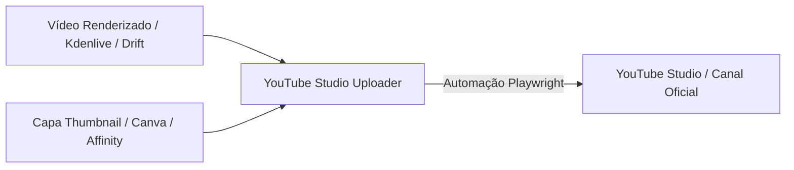

---
name: youtube-studio-uploader
description: >-
  Automação completa para upload de vídeos e capas (thumbnails) no YouTube Studio via YouTube MCP / Playwright. Permite enviar vídeos renderizados (.mp4, .mkv), anexar capas geradas no Canva ou Affinity, configurar títulos, descrições otimizadas, tags e visibilidade (Público, Não-listado ou Privado).
---

# YouTube Studio Uploader Automation

Esta skill automatiza a publicação e o upload de vídeos no **YouTube Studio** integrando a pipeline completa de produção de conteúdo do Alex: **Edição (Kdenlive / Drift) ➔ Design de Capas (Canva / Affinity) ➔ Publicação no YouTube**.

---

## 🚀 Fluxo de Trabalho Integrado



---

## 🛠️ Como Executar Uploads

### 1. Via Ferramenta MCP (`youtube_upload_video`)
```python
youtube_upload_video(
    video_path="D:/caminho/do/video.mp4",
    thumbnail_path="D:/caminho/da/capa.png",
    title="Criando Meu Jogo 2.5D na Unity 6 com IA",
    description="Neste vídeo mostro o processo de desenvolvimento...",
    tags="unity, gamedev, devlog, 3d, blender, ia",
    visibility="unlisted"  # 'public', 'unlisted' ou 'private'
)
```

### 2. Via Linha de Comando (Direto no Python):
```bash
cd D:\GitHub\youtube-mcp
python browser.py upload "D:\caminho\video.mp4" "D:\caminho\capa.png" "Título do Vídeo"
```

---

## 📋 Boas Práticas para Metadados de Vídeo

1. **Título (Máx. 100 caracteres):**
   - Direto, instigante e com palavras-chave principais no início.
   - Exemplo: `CRIANDO JOGO 2.5D NA UNITY 6 COM IA | Devlog #01`

2. **Capa / Thumbnail (1280x720):**
   - Usar as capas geradas no Canva (`canva-capas-canal`) ou Affinity (`affinity-design`).
   - Alto contraste e textos legíveis em telas pequenas.

3. **Visibilidade Recomendada:**
   - **`unlisted` (Não-listado):** Ideal para revisão prévia ou checagem de processamento em HD/4K.
   - **`public` (Público):** Publicação imediata para os inscritos.
   - **`private` (Privado):** Apenas o proprietário tem acesso.